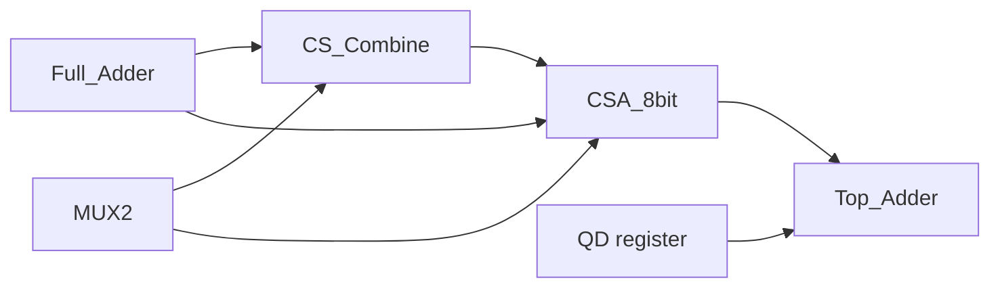

# 8-bit Conditional-Sum Adder — RTL to GDS

A registered 8-bit **Conditional-Sum Adder** written in structural VHDL and taken through a full Cadence ASIC flow: RTL simulation, synthesis at **45 nm** and **7 nm (ASAP7)**, place & route with clock tree synthesis, gate-level simulation with SDF back-annotation, and formal logic equivalence checking.

Lab project for **VLSI Design II**, Department of Electrical and Computer Engineering, University of Patras (Group 8).

---

## Overview

A ripple-carry adder has a delay that grows linearly with the word length, because each carry must wait for the previous one. The conditional-sum adder removes that chain: every block computes its result **twice in parallel**, once assuming carry-in = 0 and once assuming carry-in = 1. When the real carry arrives, a multiplexer simply picks the correct result.

The blocks are merged hierarchically, doubling in width at each level, so the carry selection takes log2(N) multiplexer stages instead of N full-adder stages:

| Level | Block width | Blocks | Built with |
|-------|-------------|--------|------------|
| 0 | 1 bit | 8 | 2 Full Adders per bit (cin = 0 and cin = 1) |
| 1 | 2 bit | 4 | `CS_Combine` with `W = 1` |
| 2 | 4 bit | 2 | `CS_Combine` with `W = 2` |
| 3 | 8 bit | 1 | `CS_Combine` with `W = 4` |
| Final | 8 bit | — | `MUX2` selected by the external `cin` |

Reference: N. Weste and D. Harris, *CMOS VLSI Design*, Section 11.2.2.7 (Figure 11.27, conditional-sum adder).

---

## Design hierarchy



| File | Description |
|------|-------------|
| `Full_Adder.vhd` | 1-bit full adder (dataflow) |
| `MUX2.vhd` | Generic N-bit 2-to-1 multiplexer, used for both sum vectors and carries |
| `QD.vhd` | Generic N-bit D register with asynchronous reset |
| `CS_Combine.vhd` | Generic block (`W`): merges two W-bit conditional-sum blocks into one 2W-bit block. Keeps `s0/cout0` (carry-in 0) and `s1/cout1` (carry-in 1); the lower half's carry-out selects the upper half |
| `CSA_8bit.vhd` | Purely combinational 8-bit conditional-sum core (levels 0–3 + final selection) |
| `Top_Adder.vhd` | Top level: input registers → `CSA_8bit` → output registers |
| `testbench.vhd` | Self-checking testbench with corner cases (overflow, all-ones, carry-in) |

### Timing / latency

```
A_in, B_in, Cin_in → REG_A / REG_B / REG_CIN → CSA_8bit → REG_SUM / REG_COUT → S_out, Cout_out
```

Inputs and outputs are registered, so a valid result appears after **2 clock cycles** (latency = 2). The design has 26 flip-flops (8 + 8 + 1 input, 8 + 1 output).

---

## Repository structure

```
.
├── rtl/
│   ├── Full_Adder.vhd
│   ├── MUX2.vhd
│   ├── QD.vhd
│   ├── CS_Combine.vhd
│   ├── CSA_8bit.vhd
│   └── Top_Adder.vhd
├── tb/
│   └── testbench.vhd
├── docs/
│   ├── report.pdf
│   ├── presentation.pdf
│   └── images/
└── README.md
```

---

## RTL simulation (ModelSim)

```tcl
vlib work
vcom rtl/Full_Adder.vhd rtl/MUX2.vhd rtl/QD.vhd rtl/CS_Combine.vhd rtl/CSA_8bit.vhd rtl/Top_Adder.vhd
vcom tb/testbench.vhd
vsim work.testbench
add wave -radix binary /testbench/*
run -all
```

The testbench applies each vector, waits two rising clock edges and compares `{Cout_out, S_out}` against the expected sum using `assert`. Example:

```
A = 10111011 (187)   B = 01110010 (114)   Cin = 0
S_out = 00101101 (45)   Cout_out = 1        → 187 + 114 = 301 = 1_0010_1101
```

<!--  -->

---

## Synthesis (Cadence Genus)

Clock period: **1.5 ns**.

| Parameter | 45 nm (`slow_1v0`) | 7 nm (ASAP7, `PVT_0P7V_25C`) | Change |
|-----------|-------------------|------------------------------|--------|
| Cell count | 68 | 82 | +20.6 % |
| Total cell area (µm²) | 235.980 | 14.186 | −94.0 % |
| Total power | 252.35 µW | 38.16 µW | −84.9 % |
| Critical data path | 1377 ps | 403 ps | −70.7 % |
| Setup slack | +9 ps | +1070 ps | — |

- In both nodes most of the power is drawn by the registers (86.6 % at 45 nm, 77.3 % at 7 nm).
- At 45 nm the design only just meets 1.5 ns; at 7 nm there is room to raise the clock frequency considerably.
- The higher cell count at 7 nm comes from Genus mapping to a different library with smaller, simpler cells.

<!--  -->
<!--  -->

---

## Physical design (Cadence Innovus, 45 nm)

**First run (ideal clock):** floorplan with core margin, VDD/VSS power rings and stripes, placement and routing.
- Post-route setup slack: **+0.346 ns** (required 1.388 ns, arrival 1.042 ns)
- Critical path: `REG_CIN_q_reg[0]` → `REG_SUM_q_reg[7]`

**Second run (with Clock Tree Synthesis):** the clock is routed as a real net instead of an ideal one.
- Clock tree: 26 sinks driven directly from `clk` (star topology; no clock buffers needed for a design this small)
- Post-route setup slack: **+0.204 ns** at 1.5 ns
- Critical path: `REG_A_q_reg[1]` → `REG_COUT_q_reg[0]`
- Verify Connectivity: **0 violations, 0 warnings**
- Verify DRC: **0 violations**
- Die boundary: 32.0 × 30.78 µm

<!--  -->
<!--  -->

---

## Verification

### Gate-level simulation (Cadence Xcelium + SDF)
The synthesized netlist `Top_Adder_m.v` was simulated with the delays back-annotated from `Top_Adder_m.sdf` (clock period 1500 ps). All vectors pass:

```
PASS: A=00000000 B=00000000 Cin=0 -> Cout=0 S=00000000
PASS: A=00000001 B=00000001 Cin=0 -> Cout=0 S=00000010
PASS: A=00001111 B=00000001 Cin=1 -> Cout=0 S=00010001
PASS: A=10111011 B=01110010 Cin=0 -> Cout=1 S=00101101
PASS: A=10111011 B=01110010 Cin=1 -> Cout=1 S=00101110
PASS: A=11111111 B=00000000 Cin=1 -> Cout=1 S=00000000
PASS: A=11111111 B=11111111 Cin=0 -> Cout=1 S=11111110
PASS: A=11111111 B=11111111 Cin=1 -> Cout=1 S=11111111
PASS: A=01010101 B=00101010 Cin=0 -> Cout=0 S=01111111
PASS: A=10000000 B=10000000 Cin=0 -> Cout=1 S=00000000
```

### Logic Equivalence Check (Cadence Conformal LEC)
Golden (VHDL RTL) vs. revised (synthesized Verilog netlist):

| | Primary inputs | Primary outputs | DFFs |
|---|---|---|---|
| Mapped points | 19 | 9 | 26 |

All **35 compare points** (9 outputs + 26 DFFs) are **equivalent** → compare result **PASS**.

---

## Tools

| Step | Tool |
|------|------|
| RTL simulation | Mentor ModelSim |
| Synthesis | Cadence Genus 22.13 |
| Place & route, CTS | Cadence Innovus 22.33 |
| Gate-level simulation | Cadence Xcelium |
| Formal equivalence | Cadence Conformal LEC |

---

## Authors

- Theodoros Latsis
- Konstantinos Katsantonis

Department of Electrical and Computer Engineering, University of Patras.
